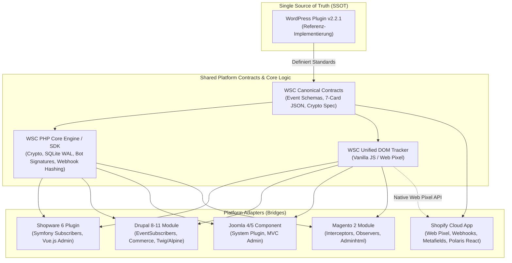

# WSC Cross-Platform Feature & Architecture Matrix
**Single Source of Truth (SSOT): WordPress Plugin v2.2.1**  
*Datum:* 6. September 2026 | *Status:* Genehmigt zur Portierungsplanung | *Scope:* WordPress, Shopware 6, Shopify, Drupal, Joomla, Magento 2

---

## 1. Leitphilosophie & Best Practice für Multi-Platform Architecture

Um eine Codebasis über 6 unterschiedliche CMS- und E-Commerce-Ökosysteme wartbar, konsistent und release-sicher zu halten, gilt das **Adapter-Pattern auf Basis einer geteilten Core-Architektur**:



### Die 3 goldenen Architektur-Regeln
1. **Zero-Local Aggregation**: Kein CMS führt eigene OLAP-Aggregationsberechnungen durch. Sämtliche mathematischen Durchschnitte, Deltas, AI-RAG-Anteile und Performance-Scores werden im zentralen WSC Gateway / ClickHouse berechnet und per Push-Report (Webhook oder Metafield) geliefert.
2. **Kanonische Datenverträge (Strict Schemas)**: Das vom WordPress-Plugin empfangene und gerenderte JSON-Schema der 7-Card-Suite ist für alle CMS-Systeme identisch.
3. **Plattform-spezifische Trennung**:
   - **PHP-basierte Plattformen (Shopware, Drupal, Joomla, Magento)**: Nutzen die gleiche SQLite-Edge-Queue (`queue_temp.sqlite`), dieselbe AES-256-Verschlüsselung und denselben HMAC-SHA256 Webhook-Empfänger.
   - **Shopify Cloud (SaaS)**: Nutzt die serverlose Architektur (Sandboxed Web Pixel ➔ Gateway ➔ GraphQL Metafields ➔ Polaris React).

---

## 2. Detaillierte Feature- & Funktionsmatrix (SSOT)

Die folgende Matrix bildet alle Module, Klassen und Methoden der WordPress-Referenz ([`wsc-search-health-wordpress-plugin`](file:///home/benjamin/Documents/GitHub/world-seo-council/wsc-search-health-wordpress-plugin)) auf die entsprechenden Ziel-Plattformen ab.

### Schicht 1: Telemetrie, Sensorik & Datenerfassung (Ingress)

| Feature / Funktion | WordPress SSOT Klasse / Hook | Shopware 6 | Shopify Cloud | Drupal (8-11) | Joomla (4/5) | Magento 2 |
| :--- | :--- | :--- | :--- | :--- | :--- | :--- |
| **Client-Side DOM Tracker** | `assets/js/wsc-tracker.js` (Pageview, Engaged Time, Scroll 25-100%, TTFI, Focus, Outbound) | Storefront Script via `StorefrontRenderEvent` | Sandboxed Web Pixel (`extensions/wsc-web-pixel`) | `hook_page_attachments` Library | System Plugin `onAfterDispatch` | Layout XML `default.xml` Block |
| **Bot & AI Crawler Interceptor** | `class-wsc-bot-tracker.php` (`plugins_loaded`, Pre-Cache Hook) | `KernelEvents::REQUEST` Subscriber (Prio 2048, vor HTTP-Cache) | *Nicht nativ möglich* (Erfassung via Cloudflare / Gateway Edge Proxy) | `KernelEvents::REQUEST` Subscriber (Prio 300) | `onAfterInitialise` Event | `aroundDispatch` Interceptor auf `FrontController` |
| **E-Commerce Order Capture** | `class-wsc-woocommerce.php` (`woocommerce_thankyou` / `order_status_completed`) | `CheckoutOrderPlacedEvent` Subscriber | Webhook `orders/paid` an Gateway `/v1/shopify/webhook` | `hook_entity_insert` auf `commerce_order` | Order Event in VirtueMart / HikaShop | `sales_order_place_after` Observer |
| **E-Commerce Funnel Tracking** | `product_view`, `add_to_cart`, `initiate_checkout` in `class-wsc-woocommerce.php` | Storefront Controller AJAX / DOM Hooks | Standard Web Pixel Analytics Events | Drupal Commerce EventSubscribers | JS Tracker eCommerce Erweiterung | Frontend Customer Data Private Content |
| **UTM & Campaign Ingestion** | `class-wsc-campaigns.php` (Auto-Parsing `utm_*`, Channel Attribution) | PHP Request Ingestion & JS Cookie/Session | Web Pixel `context.document.location` | Request EventSubscriber | System Plugin Request Filter | Request Plugin / Cookie Reader |

---

### Schicht 2: Edge-Storage, Kryptographie & Cloud-Synchronisation

| Feature / Funktion | WordPress SSOT Klasse / Spezifikation | Shopware 6 | Shopify Cloud | Drupal (8-11) | Joomla (4/5) | Magento 2 |
| :--- | :--- | :--- | :--- | :--- | :--- | :--- |
| **SQLite Queue Engine** | `class-wsc-analytics.php` (`queue_temp.sqlite` in WAL-Modus) | `var/wsc_analytics/queue_temp.sqlite` via SQLite3 | *Entfällt* (Web Pixel sendet direkt via HTTPS an Gateway) | `private://wsc_analytics/queue_temp.sqlite` | `administrator/cache/wsc/queue_temp.sqlite` | `var/wsc_analytics/queue_temp.sqlite` |
| **Batch Encryption & Dispatch** | `class-wsc-analytics.php` (AES-256-CBC mit `local_aes_key`, HMAC `X-WSC-Sig`) | `WscBatchSyncService` via `ScheduledTask` (5 Min.) | *Entfällt* (Gateway sichert Ingestion) | `WscSyncWorker` via Drupal Cron | Joomla System Task / Cron Plugin | Magento Cronjob (`crontab.xml`) |
| **HMAC Webhook Receiver** | `class-wsc-core.php` (`POST /wp-json/wsc/v1/webhook`) | Storefront/API Controller `POST /api/wsc/webhook` | Gateway mutiert via GraphQL `metafieldsSet` | Controller `POST /api/wsc/webhook` | Component Controller `index.php?option=com_wsc&task=webhook` | Controller `POST /wsc/api/webhook` |
| **SQLite Report Store** | `class-wsc-data.php` (`reports_temp.sqlite` / Options Cache) | `reports_temp.sqlite` + System Config Cache | Shopify Shop Metafield (`namespace: "wsc_analytics"`) | `reports_temp.sqlite` + State API | `reports_temp.sqlite` + Extension Params | `reports_temp.sqlite` + Core Flag / Cache |

---

### Schicht 3: Die kanonische 7-Card Report Suite (Analytics Hub)

Alle Plattformen rendern dieselbe visuelle Logik basierend auf den vom Gateway gelieferten Payloads:

| Bento Card | SSOT Schlüssel | Kern-Metriken & Visualisierung | UI-Komponente (WordPress SSOT) | Ziel-UI (Shopware 6 / Shopify / Drupal) |
| :--- | :--- | :--- | :--- | :--- |
| **Card 1: Real Visitors & Traffic** | `card1_traffic` | Unique Visitors, Pageviews, Engaged Time, Orders, Conversion Revenue, WoW/MoM Sparkline, Multi-Period Selector (1d, 7d, 30d, 90d, 180d, 365d) | `assets/js/wsc-dashboard.js` & `class-wsc-dashboard-cards.php` | **SW6:** Vue.js Component<br>**Shopify:** `WscTrafficCard.jsx`<br>**Drupal:** Twig + Chart.js |
| **Card 2: Strategic Insights** | `card2_insights` | Automatisch generierte Text-Insights, Traffic-Trends, Anomalie-Warnungen, Top-Konvertierer, Handlungsempfehlungen | Bento Card Template (`wsc-card-insights`) | **SW6:** Vue.js Component<br>**Shopify:** `WscInsightsCard.jsx`<br>**Drupal:** Twig Template |
| **Card 3: Bot Shield & AI Scrapers** | `card3_bots` | Human vs. Bot Ratio, AI RAG Bots (Perplexity, OAI-Search), AI Training Scraper (GPTBot, ClaudeBot), Search Indexers | 3-Segment Donut Chart + Bot-Typ Aufschlüsselung | **SW6:** Vue.js Component<br>**Shopify:** `WscBotCard.jsx`<br>**Drupal:** Twig + SVG Chart |
| **Card 4: Engagement & UX Reality** | `card_engagement` | Engaged Reading Time (Ø), TTFI (Time to First Interaction), Scroll-Meilensteine (25/50/75/100%), UX Badges (*Deep Reader Favorite*, *Intent Mismatch*) | 4-Säulen Milestone Bar + UX Diagnose-Chips | **SW6:** Vue.js Component<br>**Shopify:** `WscEngagementCard.jsx`<br>**Drupal:** Twig Component |
| **Card 5: Outbound Link Intelligence** | `card_outbound` | Kategoriematrix externer Klicks (Jobs, Social, Affiliate, Reference), Top 10 Ziel-Domains | Horizontale Kategorie-Balken + Domain-Tabelle | **SW6:** Vue.js Component<br>**Shopify:** `WscOutboundCard.jsx`<br>**Drupal:** Twig Component |
| **Card 6: E-Commerce Funnel Reality** | `card_ecommerce` | 4-Stufen Checkout-Ampel (Views ➔ Carts ➔ Checkout ➔ Sale), Drop-off Leaks, Product Velocity Matrix, Coupon Margin Protection | Interaktiver Funnel-Trichter + Velocity Scatter Matrix | **SW6:** Vue.js Component<br>**Shopify:** `WscEcommerceCard.jsx`<br>**Drupal:** Commerce Dashboard |
| **Card 7: Sentinel Domain Health** | `domain_health` / `sentinel` | DNS Redundanz, DNSSEC, Port-25-freie Mail-Sicherheit (MX, SPF, DMARC), SSL Zertifikatslaufzeit, Security Header, Drift-Status | Bento Health Ampel mit Proactive Action Remediation | **SW6:** Vue.js Component<br>**Shopify:** `WscSentinelCard.jsx`<br>**Drupal:** Status Report View |

---

### Schicht 4: Spezial-Engines & Hub-Erweiterungen

| Engine / Modul | WordPress SSOT Klasse | Funktionsumfang & Gateway Schnittstelle | Portierungs-Anforderung für andere Plattformen |
| :--- | :--- | :--- | :--- |
| **SpeedSentinel 2.0** | `class-wsc-pagespeed.php` & `class-wsc-health-admin.php` | Asynchrone Audits (`POST /v1/pagespeed/audit` ➔ HTTP 202). Dual-Indicator Thermometer (🤖 RAG Readiness vs. 👤 Human Core Web Vitals LCP, TBT, CLS, FCP, TTFB). | Frontend Trigger Button + Polling Controller (120s Transient) + Thermometer Canvas/SVG Rendering. |
| **AI Coverage URL Inspector** | `class-wsc-ai-coverage.php` & `class-wsc-ai-inspector-admin.php` | REST-Proxy (`POST /v1/ai-coverage/query`). URL-Eingabe mit Schnellwahl. Visualisierung von RAG Bot Crawls vs. Training Scraper Besuchen. | API Controller zur Weiterleitung signierter HMAC-Anfragen + AJAX Inspector Suchleiste im Dashboard. |
| **Sentinel Studio 2.2.1** | `class-wsc-tech-health.php` | Asynchroner Scan (`POST /v1/sentinel/scan` ➔ HTTP 202). Polling Transient, animiertes Live-Step Banner (DNSSEC ➔ Mail ➔ SSL ➔ Drift). | REST-Route im CMS + UI Progress-Banner Controller (`initSentinelStudio`). |
| **WSC Membership & Partner Feed** | `class-wsc-membership.php` | Lizenzverifizierung (`/v1/license`), automatischer wöchentlicher Check, Partner Directory Feed mit 12h Cache, Co-Branding. | Standardisierter Lizenz-Schlüssel in Plugin-Settings + Partner-Feed Caching im CMS-Config-Speicher. |
| **Sponsor Engine & Placements** | `class-wsc-sponsors.php` | Werbefreiheit für WSC-Mitglieder (`is_active_licensed()`), Spotlight Bento Card mit 14-Tage Dismissal, Kontext-Banner Slots. | Gating-Funktion: Anzeigen nur rendern, wenn Lizenz unbezahlt/Free. Dismissal-Status in LocalStorage oder UserSettings speichern. |
| **Smart Questions Engine** | `class-wsc-smart-questions.php` | Heuristische Matrix für proaktive Fragen bei Daten-Anomalien (z. B. AI-Traffic Spike, Checkout Drop-off). | Evaluierungs-Funktion bei Laden des Dashboards. |

---

### Schicht 5: 5-Hub Navigations-Konzept & UI Frameworks

Das WordPress-Plugin gliedert sich in 5 Hubs. Die Portierung in die Zielsysteme nutzt die nativen Navigationsmuster des jeweiligen CMS:

```
┌────────────────────────────────────────────────────────────────────────────────────────┐
│ Hub 1: 🎛️ Command Center (Bento Grid, Pinned Cards, Fast Scan Action)                   │
│ Hub 2: 📊 Live Telemetry & Traffic (Real Visitors Studio, Bot Shield, E-Commerce Funnel)│
│ Hub 3: 🔍 SEO & Indexing Suite (Scoreboard, Meta Tools, Schema Markup, IndexNow)       │
│ Hub 4: 🛡️ Tech Health & Sentinel (SpeedSentinel, Sentinel Studio, 404 & Redirects)     │
│ Hub 5: ⚙️ Settings & Governance (Credentials, Module Whitelist, Data Privacy, Lizenz)  │
└────────────────────────────────────────────────────────────────────────────────────────┘
```

#### Framework-Mapping:
* **WordPress**: Native WordPress Admin Theme, Dashicons, Vanilla JS + ECharts (`assets/js/wsc-dashboard.js`).
* **Shopware 6**: Shopware Administration Module auf Basis von **Vue.js 3 / Twig**, Integration in Hauptmenü unter `Marketing` ➔ `World Search Council`.
* **Shopify Cloud**: **Shopify App Bridge & Polaris React** (`@shopify/polaris`), eingebettet direkt im Shopify Merchant Admin.
* **Drupal (8–11)**: **Drupal Admin Controller + Twig Templates**, Styling via Drupal Claro Admin Theme & Modern CSS Grid.
* **Joomla (4/5)**: **Joomla MVC Administrator Component** (`com_wsc_analytics`) mit Atum Admin Layout und CSS Grid.
* **Magento 2**: **Adminhtml Block & Layout XML** unter `Marketing` ➔ `WSC Analytics`, UI-Components mit Knockout.js oder Vanilla ES6.

---

## 3. Strategischer Umsetzungs-Fahrplan (Roadmap)

### Phase 1: Shared PHP Core SDK & Kanonische Schemas (Fundament)
1. **Extraktion des `wsc-php-core`**:
   - Bereitstellung einer leichtgewichtigen, vendor-unabhängigen PHP-Bibliothek (PHP 8.1+) mit den Klassen:
     - `WscCrypto`: AES-256-CBC Payload Encryption & HMAC-SHA256 Signatures.
     - `WscSqliteStorage`: WAL-Modus Queue- und Report-Verwaltung.
     - `WscBotDetector`: Regex-Signaturen für AI RAG, Scraper und Suchmaschinen.
     - `WscContractValidator`: Validierung empfangener Webhook-Payloads gegen die 7-Card Schemas.
2. **Kanonische JSON-Schemata exportieren**:
   - OpenAPI / JSON-Schema Spezifikationen für alle 7 Bento Cards und Worker-Push-Payloads zur Validierung in Tests.

### Phase 2: Shopware 6 (`wsc-core-shopware6`) auf v2.2 Standard
1. **Backend**:
   - Einbindung des `WscBatchSyncService` und des `WscWebhookController` mit voller Unterstützung für die 7-Card Payloads.
   - Anbindung des `CheckoutOrderPlacedEvent` für das 4-Stufen E-Commerce Funneling.
2. **Vue.js Administration**:
   - Modernisierung der Vue-Komponenten im Shopware-Admin auf das 5-Hub Bento-Grid.
   - Einbindung von SpeedSentinel & Sentinel Studio mit asynchronem Scan-Trigger.

### Phase 3: Shopify Embedded App (`wsc-shopify`) auf v2.2 Standard
1. **GraphQL Metafield Sync**:
   - Erweiterung des Gateway-Dispatchers zur Speicherung aller 7 Cards im Shop-Metafield `wsc_analytics:dashboard_cards`.
2. **Polaris React UI**:
   - Erstellung der fehlenden Karten (`WscEngagementCard.jsx`, `WscOutboundCard.jsx`, `WscEcommerceCard.jsx`, `WscSentinelCard.jsx`).
   - Implementierung des 5-Hub Tab-Layouts mit `@shopify/polaris`.
   - SpeedSentinel Trigger über Gateway REST API mit Polling.

### Phase 4: Drupal (8–11) & Joomla (4/5) Synchronisation
1. **Drupal Commerce & Twig Admin**:
   - Update des `WscWebhookController` und Erweiterung des `wsc-dashboard.html.twig` auf das 7-Card Bento Raster.
2. **Joomla Administrator Component**:
   - Modernisierung von `com_wsc_analytics` auf Joomla 5 native Service-Provider und 7-Card Views.

### Phase 5: Magento 2 Adapter
1. **Observer & Adminhtml**:
   - Validierung von `sales_order_place_after` und Aktualisierung des Adminhtml Dashboard Blocks auf die 7-Card Suite.
