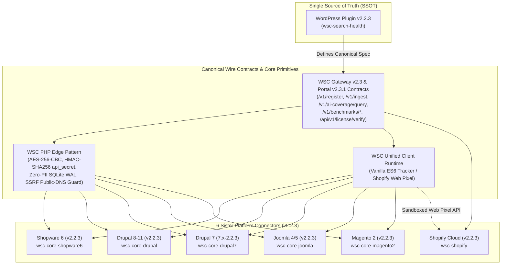

# RFC-0005: Cross-Platform Feature & Architecture Matrix (`v2.2.3`)

- **RFC ID:** `RFC-0005`
- **Status:** `Standard` (100% Implemented & Verified — 84/84 Parity Checks)
- **Single Source of Truth (SSOT):** [`wsc-search-health`](https://github.com/World-Search-Council/wsc-search-health) (`v2.2.3`)
- **Last Updated:** November 13, 2026
- **Scope:** WordPress 6.0+, Shopware 6.5/6.6, Shopify Cloud, Drupal 8–11, Drupal 7 LTS, Joomla 4/5, Magento 2 / Adobe Commerce

---

## 1. Architectural Philosophy & Adapter Pattern

To maintain strict behavioral, cryptographic, and visual parity across **7 heterogeneous CMS and e-commerce ecosystems**, all official WSC connectors implement a unified **Adapter Pattern over Canonical Wire Contracts**:

### Mandatory Ecosystem Rules (`v2.2.3`)

1. **Strict Gateway-Only Telemetry & Zero Outbound Port 25:** No CMS or storefront connector ever connects directly to ClickHouse or TCP Port 25. All cloud synchronization, Sentinel scans, SpeedSentinel audits, and AI Coverage queries flow strictly through `https://api.worldsearchcouncil.org` authenticated via `HMAC-SHA256` (`X-WSC-Sig` with `api_secret`) and encrypted via `AES-256-CBC`.
2. **100% Cookieless, Strict Zero-PII & Strict Opt-In:** Connectors never set analytics cookies, never store raw client IP addresses in local SQLite queues (`SHA256(IP + UA + DailySalt)`), and never transmit external handshakes prior to explicit administrator opt-in (`hybrid_enabled = false/0`, `indexnow_enabled = false/0`).
3. **Live Authority Portal Bridge & 100% Ad-Free Licensed Workspaces:** Credentials (`WSC-MEMBER-*`, `WSC-AGENCY-*`, `WSC-PARTNER-*`) validate live against `POST https://www.worldsearchcouncil.org/api/v1/license/verify` (while keeping 100% of local features unlocked without any license key). Active licensed installs suppress all partner/sponsor placements and enable bidirectional Agency Co-Branding.
4. **SSRF & Same-Host Isolation:** Every CMS-initiated SpeedSentinel and Domain Sentinel trigger validates public DNS resolution (`FILTER_FLAG_NO_PRIV_RANGE | FILTER_FLAG_NO_RES_RANGE` / non-private IP checks) and enforces exact hostname matching against the registered site domain.

---

## 2. 7-Platform Feature & Wire-Contract Matrix (`v2.2.3`)

### Layer 1: Telemetry, Zero-PII Sensors & E-Commerce Ingress

| Capability | [WordPress](https://github.com/World-Search-Council/wsc-search-health) | [Shopware 6](https://github.com/World-Search-Council/wsc-core-shopware6) | [Shopify](https://github.com/World-Search-Council/wsc-shopify) | [Drupal 8–11](https://github.com/World-Search-Council/wsc-core-drupal) | [Drupal 7](https://github.com/World-Search-Council/wsc-core-drupal7) | [Joomla 4/5](https://github.com/World-Search-Council/wsc-core-joomla) | [Magento 2](https://github.com/World-Search-Council/wsc-core-magento2) |
| :--- | :--- | :--- | :--- | :--- | :--- | :--- | :--- |
| **Release Version** | `2.2.3` | `2.2.3` | `2.2.3` | `2.2.3` | `7.x-2.2.3` | `2.2.3` | `2.2.3` |
| **Client DOM Tracker** | `assets/js/wsc-tracker.js` | Storefront Script | Sandboxed Web Pixel | `hook_page_attachments` | `hook_init` (`wsc-tracker.js`) | `onBeforeCompileHead` | `default.xml` (`Tracker.php`) |
| **Zero-PII Session Hash** | `SHA256(IP+UA+Salt)` | `SHA256(IP+UA+Salt)` | Edge Zero-PII | `SHA256(IP+UA+Salt)` | `SHA256(IP+UA+Salt)` | `SHA256(IP+UA+Salt)` | `SHA256(IP+UA+Salt)` |
| **Pre-Cache Bot Sensor** | `plugins_loaded` | `KernelEvents::REQUEST` | Gateway / App Proxy | `KernelEvents::REQUEST` | `hook_boot()` | `onAfterInitialise` | `FrontControllerPlugin` |
| **Server-Side Orders** | `WSC_WooCommerce` | `CheckoutOrderPlacedEvent` | `orders/paid` Webhook | `commerce_order` Hook | `wsc_daily_overview` / Views 3 | VirtueMart / HikaShop | `OrderPlaceAfterObserver` |

---

### Layer 2: Gateway `v2.3` Wire Contract, SQLite WAL & Cryptography

| Capability | WordPress SSOT | Shopware 6 | Shopify Cloud | Drupal 8–11 | Drupal 7 | Joomla 4/5 | Magento 2 |
| :--- | :--- | :--- | :--- | :--- | :--- | :--- | :--- |
| **Strict Opt-In Default** | `hybrid = 0` | `hybrid = false` | `hybrid = false` | `hybrid = false` | `hybrid = 0` | `hybrid = 0` | `hybrid = 0` |
| **`POST /v1/register` (`v2.3`)** | `project_id` + `api_secret` | `project_id` + `api_secret` | `project_id` + `api_secret` | `project_id` + `api_secret` | `project_id` + `api_secret` | `project_id` + `api_secret` | `project_id` + `api_secret` |
| **`POST /v1/ingest` Envelope** | `AES-256-CBC` + `api_secret` HMAC | `AES-256-CBC` + `api_secret` HMAC | Gateway Pixel / Proxy | `AES-256-CBC` + `api_secret` HMAC | `AES-256-CBC` + `api_secret` HMAC | `AES-256-CBC` + `api_secret` HMAC | `AES-256-CBC` + `api_secret` HMAC |
| **Edge Storage Engine** | Dual SQLite `WAL` | `var/wsc_analytics/*.sqlite` | GraphQL Metafields (`wsc_analytics`) | `private://wsc_analytics/*.sqlite` | `private://wsc_analytics/*.sqlite` | `administrator/cache/wsc_analytics` | `var/wsc_analytics/*.sqlite` |
| **Multi-Period Switcher** | `1d`–`365d` | `1d`–`365d` | `1d`–`365d` | `1d`–`365d` | `1d`–`365d` | `1d`–`365d` | `1d`–`365d` |

---

### Layer 3: Canonical 7-Card Bento Suite

All 7 platforms ingest and render the identical 7-Card Bento report schema across `1d`, `7d`, `30d`, `90d`, and `365d` windows:

| Bento Card | Canonical Key | Core Metrics & Diagnostics |
| :--- | :--- | :--- |
| **Card 1: Real Visitors & Traffic** | `card1_traffic` | Unique Visitors, Pageviews, Engaged Time, Orders, Revenue, Channel Attribution (AI, Search, Social, Direct, Referral). |
| **Card 2: Strategic Insights** | `card2_insights` | Algorithmic growth summaries, anomaly alerts, and prioritized SEO/GEO/UX action items. |
| **Card 3: Bot Shield & AI Crawlers** | `card3_bots` | Human vs. Bot ratio, Live RAG Retrieval Agents (`ChatGPT-User`, `OAI-SearchBot`, `PerplexityBot`), AI Training Scrapers (`GPTBot`, `ClaudeBot`, `CCBot`), and Search Spiders (`Googlebot`, `Bingbot`). |
| **Card 4: Engagement & UX Reality** | `card_engagement` | Active Engaged Reading Time, Time to First Interaction (TTFI), Scroll Milestones (`25%`/`50%`/`75%`/`100%`), and UX Verdict chips. |
| **Card 5: Outbound Link Intelligence** | `card_outbound` | Categorized external clicks (`Jobs`, `Social`, `Affiliate`, `Reference`) and top destination domains. |
| **Card 6: E-Commerce Funnel Reality** | `card_ecommerce` | 4-Stage Checkout Funnel (`Product Views` → `Add to Cart` → `Initiate Checkout` → `Purchase`), drop-off diagnosis, and product velocity. |
| **Card 7: Domain & Speed Sentinel** | `domain_health` + `pagespeed` | Port-25-free DNSSEC, MX/SPF/DMARC, X.509 SSL lifecycle, 6/6 Security Headers, Drift status, and **SpeedSentinel 2.0 Dual-Thermometer** (🤖 RAG Readiness vs. 👤 Human CWV). |

---

### Layer 4: Specialized Engines, Authority Portal Bridge & AI Discovery (`v2.2.3`)

| Engine / Endpoint | WordPress SSOT | Shopware 6 | Shopify Cloud | Drupal 8–11 | Drupal 7 | Joomla 4/5 | Magento 2 |
| :--- | :---: | :---: | :---: | :---: | :---: | :---: | :---: |
| **SpeedSentinel 2.0 (`/v1/pagespeed/audit`) + SSRF Guard** | ✅ | ✅ | ✅ | ✅ | ✅ | ✅ | ✅ |
| **Port-25-Free Sentinel (`/v1/sentinel/scan`) + SSRF Guard** | ✅ | ✅ | ✅ | ✅ | ✅ | ✅ | ✅ |
| **AI Coverage Inspector (`/v1/ai-coverage/query` + Local Fallback)** | ✅ | ✅ | ✅ | ✅ | ✅ | ✅ | ✅ |
| **Dynamic Cloud Benchmarks (`/v1/benchmarks/{query,classify}`)** | ✅ | ✅ | ✅ | ✅ | ✅ | ✅ | ✅ |
| **Live WSC Member Verify (`/api/v1/license/verify` + Co-Branding)** | ✅ | ✅ | ✅ | ✅ | ✅ | ✅ | ✅ |
| **Featured Partners (`/api/v1/partners/featured`, 100% Ad-Free Licensed)** | ✅ | ✅ | ✅ | ✅ | ✅ | ✅ | ✅ |
| **Dynamic `/llms.txt` AI Discovery Manifest** | `/llms.txt` | `/llms.txt` | `/apps/wsc/llms.txt` | `/llms.txt` | `/llms.txt` | `/llms.txt` | `/llms.txt` |
| **Opt-In `IndexNow` + Auto-Content/Product Hook + `/{key}.txt`** | `save_post` | `WscProductSubscriber` | `products/update` | `hook_entity_*` | `hook_node_*` | `onContentAfterSave` | `ProductSaveAfterObserver` |
